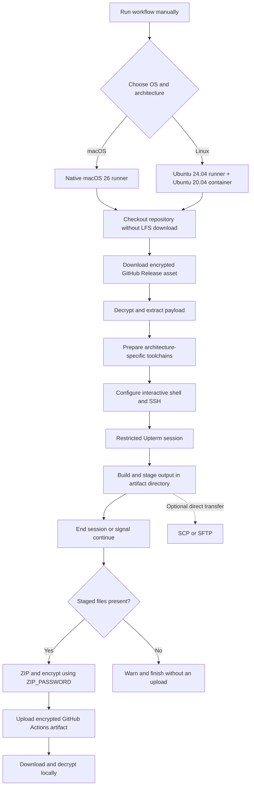
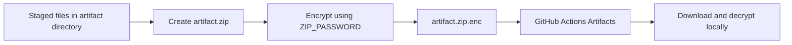

<a id="top"></a>

<div align="center">

# 🐧 🍎 Unix Runner

### Four runner configurations. Two operating systems. Two CPU architectures.

**On-demand GitHub Actions runners for building, packaging, and debugging native Unix applications over SSH.**

[](https://github.com/actions/runner-images)
[](https://ubuntu.com/)
[](#runner-matrix)
[](https://github.com/jgfPereira/unix-runner/actions)

**[Quick start](#quick-start)** · **[Runners](#runner-matrix)** · **[Build artifacts](#encrypted-build-artifacts)** · **[Release payload](#managing-the-encrypted-payload)** · **[Toolchains](#toolchains--platform-differences)** · **[Commands](#command-reference)** · **[Troubleshooting](#troubleshooting)**

</div>

---

## Overview

**Unix Runner** turns an ordinary workflow dispatch into a temporary, remotely accessible development machine. Each run provisions the relevant build tools, decrypts an encrypted source payload, and opens a restricted [Upterm](https://github.com/owenthereal/action-upterm) SSH session for hands-on work.

It is designed for workloads where **native operating systems and CPU architectures matter**: Java `jpackage` application images, macOS `.app` / `.dmg` / `.pkg` packaging, Linux AppImage creation, native Go programs, and other architecture-specific build or debugging tasks. The runners are **project-agnostic**: bring your own encrypted source payload and run the tools or build scripts appropriate to that project.

> [!IMPORTANT]
> These are **interactive build environments**, not fully unattended build-and-release pipelines. The workflows prepare the machine and wait at Upterm; **you** run the actual build. After the session ends, they can **automatically encrypt and upload any output you have staged** as a GitHub Actions workflow artifact. No build is executed automatically, and nothing is published as a GitHub Release.

### What you get

- **Four explicitly selected environments:** macOS 26 on Apple Silicon and Intel; Ubuntu 20.04 containers on ARM64 and x64 hosts.
- **Oracle JDK 25** with `java`, `javac`, `jlink`, and `jpackage` available for Java desktop packaging.
- **Go, Maven, Python, ImageMagick, OpenSSL, ZIP utilities**, and OS-specific packaging tools.
- **Encrypted payload provisioning:** A GitHub Release asset (`payload.zip.enc`) is downloaded over HTTPS, decrypted using the `ZIP_PASSWORD` repository secret, and extracted on the runner. The asset is **publicly downloadable**; only its contents are encrypted.
- **Encrypted build artifact delivery:** After Upterm, staged output is ZIP-packaged, encrypted using `ZIP_PASSWORD`, and uploaded to the workflow run's **Artifacts** section with a **3-day retention period**. No project-specific output paths are hardcoded in the workflows.
- **Interactive SSH:** Upterm sessions restricted to the registered GitHub SSH keys of `jgfPereira`.
- **Comfortable remote terminals:** colorized Zsh/Bash sessions on macOS and Bash on Linux, with aliases and completion support.
- **Native packaging:** Apple's Xcode/macOS utilities on macOS; `appimagetool` and desktop integration utilities on Linux.

## Runner matrix

| Workflow | GitHub runner label | Actual build environment | Architecture | Interactive shell |
|:--|:--|:--|:--|:--|
| [`macos-arm64.yml`](.github/workflows/macos-arm64.yml) | `macos-26` | Native macOS 26 | Apple Silicon (`arm64`) | Zsh; Bash available |
| [`macos-x64.yml`](.github/workflows/macos-x64.yml) | `macos-26-intel` | Native macOS 26 | Intel (`x86_64`) | Zsh; Bash available |
| [`linux-arm64.yml`](.github/workflows/linux-arm64.yml) | `ubuntu-24.04-arm` | `ubuntu:20.04` Docker container | ARM64 (`aarch64`) | Bash |
| [`linux-x64.yml`](.github/workflows/linux-x64.yml) | `ubuntu-24.04` | `ubuntu:20.04` Docker container | x64 (`x86_64`) | Bash |

All four workflows are **manual** (`workflow_dispatch`) and currently use a **30-minute job timeout**. The selected architecture is the architecture of the machine executing the native build; macOS jobs are not cross-compilation containers.

### How a workflow runs



## Quick start

### 1. Prepare the GitHub repository

You need:

1. Access to [the repository](https://github.com/jgfPereira/unix-runner) and permission to run GitHub Actions workflows.
2. An SSH **public key registered with the GitHub account `jgfPereira`**. The matching private key must be available on the computer from which you connect.
3. The Actions repository secret **`ZIP_PASSWORD`**, matching the passphrase used to encrypt `payload.zip.enc`.
4. A published [**Runner Payload** release](https://github.com/jgfPereira/unix-runner/releases/tag/runner-payload) with an asset named exactly `payload.zip.enc`. See [Managing the encrypted payload](#managing-the-encrypted-payload).

Configure the secret in **Settings → Secrets and variables → Actions → New repository secret**, or use GitHub CLI:

```bash
gh secret set ZIP_PASSWORD
```

> [!NOTE]
> The password must match the one used when creating `payload.zip.enc`. Switching from LFS to GitHub Releases does **not** change the encryption format or require decrypting/re-encrypting an existing valid archive. The fixed release tag is `runner-payload`.

### 2. Start a machine

From the repository's **Actions** tab, select one of the four workflows and click **Run workflow**.

Alternatively, from a local machine with [GitHub CLI](https://cli.github.com/) authenticated:

```bash
# Apple Silicon Mac
gh workflow run macos-arm64.yml --ref main

# Intel Mac
gh workflow run macos-x64.yml --ref main

# Linux ARM64
gh workflow run linux-arm64.yml --ref main

# Linux x64
gh workflow run linux-x64.yml --ref main
```

Inspect the run from the web UI, or use:

```bash
gh run list --workflow macos-arm64.yml --limit 5
gh run watch <RUN_ID>
```

### 3. Connect through Upterm

Wait for the step **Start secure interactive SSH session**. It prints a session-specific SSH connection command in the workflow log. **Copy and use the complete command from that run**; the connection identifier is different for each session.

```bash
# Example shape only — use the exact command in the Actions log.
ssh <SESSION_ID>@uptermd.upterm.dev
```

Upterm checks that your SSH key belongs to the permitted GitHub account. A public run log does **not** grant the reader SSH access by itself.

After connecting:

```bash
# Works in both Linux and macOS sessions
uname -s
uname -m
echo "$GITHUB_WORKSPACE"
cd "$GITHUB_WORKSPACE/extracted_files"
ls -la
```

The workspace location is environment-specific. In the current setup, Linux container workspaces commonly live below `/__w/`, whereas macOS runner workspaces commonly live below `/Users/runner/work/`. **Use `$GITHUB_WORKSPACE` instead of hardcoding either path.**

### 4. Run your build

Inspect the extracted archive, identify the project directory, and run the build commands appropriate to that project:

```bash
cd "$GITHUB_WORKSPACE/extracted_files"
ls -la

# Locate common build entry points.
find . -maxdepth 4 -type f \
  \( -name 'pom.xml' -o -name 'go.mod' -o -name 'Makefile' -o -name 'build*.sh' \) \
  -print

# Example: build a Maven project (replace the directory name).
cd "$GITHUB_WORKSPACE/extracted_files/my-project"
mvn clean package
```

For projects with their own platform-specific scripts, run the relevant script from the project directory. For example:

```bash
# macOS: illustrative unsigned packaging command.
./scripts/build-macos.sh --skip-signing

# Linux: illustrative native packaging command.
./scripts/build-linux.sh
```

The script names and options above are **examples, not built-in commands**. **Unix Runner provisions the machine; your encrypted payload supplies the project, build scripts, configuration, and build outputs.** Nothing in this repository requires any specific application name or project layout.

### 5. Stage your finished build for encrypted upload

After building, find the output in your Upterm session:

```bash
find "$GITHUB_WORKSPACE/extracted_files" -type f \
  \( -name '*.AppImage' -o -name '*.dmg' -o -name '*.pkg' -o -name '*.zip' \) \
  -print
```

Create the shared staging directory and **copy** the files you want to retrieve into it:

```bash
# Run inside the Upterm SSH session (Linux or macOS).
mkdir -p "$GITHUB_WORKSPACE/artifact"

# Example: substitute the actual built-file path; choose a generic staged name.
cp "/path/to/your/build-output.zip" "$GITHUB_WORKSPACE/artifact/output.zip"

# Confirm your upload candidates are present.
ls -lh "$GITHUB_WORKSPACE/artifact"
```

The workflows inspect **only** `$GITHUB_WORKSPACE/artifact/` when preparing the upload. You can stage multiple files; the relative directory structure and filenames under `artifact/` will be included in the encrypted archive. **Copying is essential:** building a file somewhere under `extracted_files/` does not automatically stage it.

For a macOS `.app` bundle, first package it with `ditto` to preserve macOS metadata and symlinks:

```bash
# On the macOS runner; substitute the actual .app path.
ditto -c -k --keepParent "/path/to/YourApp.app" \
  "$GITHUB_WORKSPACE/artifact/output-macos.zip"
```

See [Encrypted build artifacts](#encrypted-build-artifacts) for more examples, including multiple outputs and the post-session encryption process.

### 6. Finish the Upterm session to start the upload

Only after all staged files are complete, run **one** of these commands in the Upterm session:

```bash
# End the shell, which lets the workflow continue.
exit

# Alternative (instead of exit): resume the workflow while still connected.
# touch "$GITHUB_WORKSPACE/continue"
```

Simply closing the local terminal or disconnecting the SSH client **may leave the Upterm session running**, in which case the workflow has not reached the upload steps. Check the GitHub Actions run for **Package and encrypt staged artifact** and **Upload encrypted build artifact**.

### 7. Download and decrypt the build output

Once the upload step finishes, open the workflow run under the [Actions tab](https://github.com/jgfPereira/unix-runner/actions). In its **Artifacts** section, select the entry matching the platform, such as `macos-arm64-build`. **Download it within 3 days of upload**, before it expires automatically.

The browser downloads a GitHub ZIP archive containing the encrypted file **`artifact.zip.enc`**. Extract that outer ZIP, then decrypt `artifact.zip.enc` using the same passphrase as `ZIP_PASSWORD`. If you prefer the GitHub CLI, it extracts the GitHub wrapper automatically:

```bash
# Run on your local computer; replace RUN_ID with the completed run ID.
gh run download RUN_ID --repo jgfPereira/unix-runner \
  -n macos-arm64-build -D ./downloaded
```

Then decrypt and extract the inner ZIP:

```bash
cd downloaded
openssl enc -d -aes-256-cbc -pbkdf2 \
  -in artifact.zip.enc -out artifact.zip
unzip artifact.zip -d output
```

OpenSSL prompts for the passphrase. The resulting `output/` folder contains your staged files. For more details, including **Windows PowerShell**, see [Retrieving and decrypting the build](#4-retrieve-and-decrypt-a-build).

**Optional fallback: SCP/SFTP.** You can still transfer an individual file directly from an active Upterm session, although the public relay can intermittently stall:

```bash
# Run locally, using the exact session ID and absolute path on the runner.
scp -o ServerAliveInterval=30 -l 8192 \
  '<SESSION_ID>@uptermd.upterm.dev:/ABSOLUTE/PATH/TO/ARTIFACT.zip' .
```

Modern OpenSSH normally uses SFTP for `scp`; **do not add `-O` by default**. The `-O` flag selects legacy SCP mode and may help with certain older endpoints, but it can fail in other Upterm configurations. `-l 8192` limits bandwidth to 8,192 Kbit/s (around 1 MiB/s). The GitHub Actions artifact method is preferred when SCP/SFTP is unreliable.

---

## Encrypted build artifacts

GitHub Actions workflow artifacts provide a **second, more reliable delivery path** for the output of your interactive builds. These are different from the **GitHub Release asset** that supplies the *input payload* when a runner starts.

### Why upload through GitHub Actions instead of relying on SCP?

SCP/SFTP access to Upterm traverses a shared public relay. Even when a build succeeds, file transfers can **hang during SFTP initialization, stall partway through a large copy, or fail because the relay connection drops**. Retrying can help, but repeatedly restarting a large download is inconvenient.

The new workflow steps send the encrypted output using **GitHub Actions artifact upload infrastructure**, not through your Upterm SCP/SFTP connection. Once the workflow finishes, you can download the file from the run's Artifacts section (or GitHub CLI) without keeping the SSH session alive.

| | Direct SCP/SFTP | Encrypted workflow artifact |
|:--|:--|:--|
| Transfer path | Local client → Upterm relay → runner | Runner → GitHub Actions artifact storage |
| Requires active Upterm session to retrieve | Yes | No, after upload completes |
| Behavior during relay disruption | Can hang or disconnect | Download independent of Upterm relay |
| Preparation | Give local SCP the real remote output path | Copy output to a generic staging directory |
| Encryption | SSH protects the transfer; downloaded file is otherwise unchanged | ZIP encrypted using `ZIP_PASSWORD` before upload |
| Availability | While session and runner remain active | **3 days after upload**, unless removed earlier |

> [!IMPORTANT]
> **Uploading is optional, not the build itself.** You must create the build and stage its files manually during SSH. If no files are staged, the workflow **warns but does not fail**. An upload is attempted only after the Upterm step finishes or resumes. A job that is cancelled or reaches its timeout may never execute the upload steps.

### 1. Prepare files during the SSH session

The source paths and filenames remain project-specific and are deliberately **not embedded in public workflow YAML**. All four workflows use the same generic location:

```text
$GITHUB_WORKSPACE/artifact/
```

**Stage a single file:**

```bash
mkdir -p "$GITHUB_WORKSPACE/artifact"
cp "/actual/path/to/compiled-output.zip" \
  "$GITHUB_WORKSPACE/artifact/output.zip"
```

**Stage multiple files:**

```bash
mkdir -p "$GITHUB_WORKSPACE/artifact"
cp "/path/to/application.AppImage" \
  "$GITHUB_WORKSPACE/artifact/output.AppImage"
cp "/path/to/checksums.txt" \
  "$GITHUB_WORKSPACE/artifact/checksums.txt"
```

**Stage a macOS application bundle:**

```bash
mkdir -p "$GITHUB_WORKSPACE/artifact"
ditto -c -k --keepParent "/path/to/Application.app" \
  "$GITHUB_WORKSPACE/artifact/output-macos.zip"
```

`ditto` preserves macOS bundle metadata better than copying a raw `.app` folder into a generic cross-platform ZIP. You may also stage ZIP, DMG, PKG, or other finished files directly. Any output names used above are **illustrative**.

Check the staged contents:

```bash
ls -lah "$GITHUB_WORKSPACE/artifact"
du -sh "$GITHUB_WORKSPACE/artifact"
```

A folder containing **only empty directories** does not count as an artifact; the packaging step checks for at least one file or symlink. Avoid staging symlinks to files outside this directory—copy the actual output instead. Also avoid staging unnecessary private files: everything under `artifact/` is packed.

### 2. Resume the workflow after the build is ready

When all staged copies have finished writing, end the Upterm shell:

```bash
exit
```

Alternatively, from within the session:

```bash
touch "$GITHUB_WORKSPACE/continue"
```

Both allow subsequent GitHub Actions steps to run. `touch .../continue` can resume the workflow without immediately closing your SSH terminal; **do not** touch it while files are still being built or copied. Disconnecting the client window alone is not the same as ending the hosted session. See [Upterm's continue-workflow documentation](https://github.com/owenthereal/action-upterm#continue-a-workflow).

### 3. What the workflows do automatically

After Upterm, the four workflows run two additional steps:

1. **Package and encrypt staged artifact:** if `artifact/` contains at least one file, create a ZIP in the runner's temporary directory, encrypt it with OpenSSL (`AES-256-CBC`, `PBKDF2`, salted) using `ZIP_PASSWORD`, and save **`artifact.zip.enc`** in the workspace. The temporary plaintext `artifact.zip` is deleted by the step's exit cleanup.
2. **Upload encrypted build artifact:** `actions/upload-artifact@v4` uploads only `artifact.zip.enc`, with **`compression-level: 0`** because the file is already encrypted and **`retention-days: 3`** so GitHub automatically expires it after three days. If the file does not exist, the action warns instead of failing.

The retention setting is identical for all four platforms:

```yaml
retention-days: 3
```



| Situation | Workflow behavior |
|:--|:--|
| Non-empty staging directory | ZIP, encrypt, then upload |
| Missing or empty staging directory | Emit a warning; no artifact is uploaded |
| Missing `ZIP_PASSWORD` when staging exists | Fail safely; do not upload unencrypted content |
| ZIP or encryption error | Packaging step fails; no intentional plaintext fallback |
| Successful upload | Encrypted artifact becomes downloadable from that run for **3 days** |

**Artifact names** identify the platform while keeping the project and original output path private:

| Workflow | GitHub Actions artifact name | File inside |
|:--|:--|:--|
| `macos-arm64.yml` | `macos-arm64-build` | `artifact.zip.enc` |
| `macos-x64.yml` | `macos-x64-build` | `artifact.zip.enc` |
| `linux-arm64.yml` | `linux-arm64-build` | `artifact.zip.enc` |
| `linux-x64.yml` | `linux-x64-build` | `artifact.zip.enc` |

> [!NOTE]
> **No original build path is exposed in the workflow configuration.** Only the generic `artifact/` directory and `artifact.zip.enc` are referenced. The encrypted file hides the staged contents, but its download size, artifact name, and run metadata may remain visible. Avoid printing secret paths or credentials in workflow logs or terminal output that you share.

### 4. Retrieve and decrypt a build

**Method A — GitHub website:**

1. **Within 3 days of artifact upload**, open the repository's [GitHub Actions page](https://github.com/jgfPereira/unix-runner/actions) and select the completed run.
2. Find the **Artifacts** section on the run summary, then download the relevant platform artifact, for example `macos-arm64-build`.
3. Extract the ZIP downloaded by the browser (for example, `macos-arm64-build.zip`). Its contents include **`artifact.zip.enc`**.
4. Decrypt `artifact.zip.enc` on your own computer, then extract the decrypted `artifact.zip` to access the output.

**Method B — GitHub CLI (recommended for repeat downloads):**

From your local computer, with GitHub CLI authenticated:

```bash
# Change RUN_ID and platform artifact name as needed.
gh run download RUN_ID --repo jgfPereira/unix-runner \
  -n macos-arm64-build -D ./downloaded
```

The CLI extracts GitHub's outer artifact wrapper automatically, so `./downloaded/artifact.zip.enc` is ready for decryption.

**Linux / macOS shell:**

```bash
cd downloaded
openssl enc -aes-256-cbc -d -pbkdf2 \
  -in artifact.zip.enc -out artifact.zip
unzip -t artifact.zip
unzip artifact.zip -d output
```

**Windows PowerShell:**

```powershell
# Download and extract GitHub's artifact wrapper automatically.
gh run download RUN_ID --repo jgfPereira/unix-runner -n macos-arm64-build -D .\downloaded

Set-Location .\downloaded
openssl enc -aes-256-cbc -d -pbkdf2 -in artifact.zip.enc -out artifact.zip
Expand-Archive -Path .\artifact.zip -DestinationPath .\output
```

OpenSSL prompts for the same passphrase configured in the repository secret **`ZIP_PASSWORD`**. The final `output/` folder contains the files you staged. If a staged item is itself a ZIP (e.g., `output-macos.zip`), extract that ZIP separately to access its contents.

> [!TIP]
> The artifact's name is specific to the runner, but the encrypted filename **always** remains `artifact.zip.enc`. You can inspect the output locally with `unzip -l artifact.zip` after decryption. If you downloaded using the browser, remember to extract its *outer* ZIP before running OpenSSL.

### Availability, privacy, and retention

- **Public repository:** GitHub Actions artifacts can be downloaded by people with read access to the repository. Treat `artifact.zip.enc` as publicly accessible encrypted content and protect the secret with a strong, unique passphrase.
- **Encryption:** the staged files are ZIP-packaged, then encrypted before upload. The decrypted staging files remain on the *temporary runner* until its workspace is removed; the workflow removes the temporary plaintext ZIP, not the original staged files.
- **Retention:** all four workflows explicitly set **`retention-days: 3`** in `actions/upload-artifact@v4`. Uploaded artifacts are kept for **3 days from upload**, then expire automatically (or sooner if manually deleted or a stricter repository policy applies). Download and back up important builds promptly; this is **temporary delivery, not permanent release or backup storage**. Changing the setting affects future uploads, not the expiry of already-uploaded artifacts.
- **Limits and billing:** GitHub Actions storage and artifact upload limits apply separately from GitHub Releases and Git LFS. Large outputs require sufficient time and storage quota.
- **Integrity:** OpenSSL `enc` with AES-256-CBC / PBKDF2 does not provide authenticated integrity. For important builds, verify a trusted SHA-256 checksum or a signature in addition to decrypting the file.

---

## Toolchains & platform differences

| Tool | macOS ARM64 / x64 | Linux ARM64 / x64 |
|:--|:--|:--|
| Operating system | Native macOS 26 | Ubuntu 20.04 inside Docker |
| JDK | Official Oracle JDK 25 macOS archive | Official Oracle JDK 25 Linux archive |
| Java packaging | `jpackage`, `jlink` | `jpackage`, `jlink` |
| Go | Homebrew `go` formula | Latest version downloaded from `go.dev` |
| Maven | Homebrew | Ubuntu package |
| Python | Homebrew `python` | Ubuntu package |
| ImageMagick | Homebrew; `magick` | Ubuntu package; `convert` |
| OpenSSL | Homebrew `openssl@3` | Ubuntu package |
| Shell completion | Native Zsh; Homebrew Bash completion | `bash-completion` package |
| Native packaging | `codesign`, `hdiutil`, `ditto`, `iconutil`, `sips`, `pkgbuild`, `productbuild`, Xcode CLT | `appimagetool`, `file`, `desktop-file-utils`, `binutils` |
| AppImage-specific workaround | Not applicable | `APPIMAGE_EXTRACT_AND_RUN=1` |

### Why Linux runs inside Docker

The Ubuntu 24.04 runner hosts execute a **clean Ubuntu 20.04 container** to control the Linux distribution and its runtime compatibility. That older image does not necessarily include suitable versions of Go or other tools, so the workflows explicitly bootstrap system packages, retrieve a current Go toolchain, and install architecture-matched AppImage tooling.

Docker is **not** used for macOS, because macOS `.app`/`.dmg` packaging requires native macOS tooling. Apple runners already contain Homebrew, Xcode-related tools, and OS packaging utilities. The macOS workflows therefore use those native facilities rather than reproducing Linux's `apt-get`, `update-alternatives`, GNU `objcopy`, or AppImage steps.

### Oracle JDK on macOS

The updated macOS workflows download the **Oracle JDK 25 archive matching the runner architecture**, install it into the runner user's `~/Library/Java/JavaVirtualMachines/`, and expose its `Contents/Home` directory as `JAVA_HOME`.

`JAVA_HOME` and the paths for Java, Homebrew, and OpenSSL are also written to the interactive shell configuration, so tools still resolve correctly **after connecting by SSH**, not just during GitHub Actions steps. The workflows verify `java`, `javac`, `jlink`, `jpackage`, and Maven using the configured environment.

The macOS runner also makes Apple's signing and packaging commands available, but the workflows **do not automatically sign, notarize, or publish** build outputs. Those actions require an appropriate signing identity, credentials, and a separate build/release procedure.

### Terminal behavior

| Platform | Shell features |
|:--|:--|
| macOS Zsh | Colored prompt, native `compinit` completion, history, `ls -G` aliases, Go/Java/Homebrew paths |
| macOS Bash | Colored prompt, history, aliases, Bash completion when available, Java/Homebrew paths |
| Linux Bash | Colored prompt, command aliases, completion, history, terminal size handling |

All workflows configure an SSH keepalive entry for `uptermd.upterm.dev` with `ServerAliveInterval 30` and `ServerAliveCountMax 3`.

---

## Repository layout

```text
unix-runner/
├── .github/
│   └── workflows/
│       ├── linux-arm64.yml       # Ubuntu 20.04 in ARM64 container
│       ├── linux-x64.yml         # Ubuntu 20.04 in x64 container
│       ├── macos-arm64.yml       # Native macOS 26 / Apple Silicon
│       └── macos-x64.yml         # Native macOS 26 / Intel
├── .gitignore                   # Ignore local payload files (recommended)
└── README.md

GitHub Releases (outside the Git tree)
└── runner-payload               # Fixed release tag
    └── payload.zip.enc          # Encrypted, publicly downloadable asset
```

After a workflow starts, the downloaded input payload and the optional staged build output appear **in the temporary runner workspace**, not as committed repository files:

```text
$GITHUB_WORKSPACE/
├── payload.zip.enc              # Encrypted GitHub Release input asset
├── payload.zip                  # Decrypted input, temporary runner only
├── extracted_files/
│   └── my-project/              # Example project and build scripts
│       └── ...
├── artifact/                     # Manually staged build outputs (optional)
│   ├── output.zip               # Generic example name
│   └── ...
└── artifact.zip.enc             # Encrypted output uploaded after Upterm

$RUNNER_TEMP/
└── artifact.zip                 # Temporary plaintext ZIP, cleaned up
```

`artifact.zip.enc` is an **Actions workflow artifact**; `payload.zip.enc` is a **GitHub Release input asset**. Their roles, locations, and lifecycle are different.

## Managing the encrypted payload

The payload is maintained **separately from the Git repository** as an asset on a single, published GitHub Release. This is a distribution mechanism for build inputs, **not** a GitHub Actions build artifact or a conventional application release.

| Setting | Value |
|:--|:--|
| Repository | [`jgfPereira/unix-runner`](https://github.com/jgfPereira/unix-runner) |
| Fixed release tag | **`runner-payload`** |
| Release title | `Runner Payload` |
| Asset filename | **`payload.zip.enc`** |
| Download URL | [`releases/download/runner-payload/payload.zip.enc`](https://github.com/jgfPereira/unix-runner/releases/download/runner-payload/payload.zip.enc) |
| Decryption secret | GitHub Actions repository secret **`ZIP_PASSWORD`** |

> [!IMPORTANT]
> **Keep the release tag and asset filename unchanged.** The workflows download this specific URL on each run. Updating the asset under the existing tag makes the newest payload available to the next run without changing the workflow files.

### Why we no longer use Git LFS

Earlier versions stored `payload.zip.enc` as a **Git LFS object**. Every fresh runner had to fetch that large object during checkout, consuming the repository owner's LFS download bandwidth. When the LFS budget was exceeded, checkout could fail with:

```text
batch response: This repository exceeded its LFS budget.
The account responsible for the budget should increase it to restore access.
```

GitHub Releases are better suited to this repository's workflow: a single relatively large encrypted payload is **downloaded repeatedly by temporary runners** and occasionally replaced in its entirety.

| | Git LFS (old) | GitHub Release asset (current) |
|:--|:--|:--|
| Where the payload lives | LFS object referenced by Git | Asset attached to `runner-payload` |
| Runner retrieval | Git LFS fetch during checkout | Direct HTTPS download after checkout |
| Budget impact | Consumes Git LFS storage/download allowance | Does **not** consume Git LFS allowance |
| Updating the payload | Commit and push another LFS object | Replace the asset using `--clobber` |
| Workflow changes per update | Git history changes | **None**, if tag and name stay fixed |
| Public access | LFS object in a public repository | Release asset publicly downloadable |

GitHub currently allows release asset files **under 2 GiB** each, with up to **1,000 assets per release**, and states no release-asset bandwidth cap. Other GitHub service and Actions usage policies still apply. See [GitHub's release documentation](https://docs.github.com/en/repositories/releasing-projects-on-github/about-releases).

> [!NOTE]
> Removing the file from current Git LFS tracking prevents *future* runner downloads through LFS. **It does not automatically erase LFS objects already stored in GitHub's history or immediately reclaim historical LFS storage usage.** Consult [GitHub's LFS removal documentation](https://docs.github.com/en/repositories/working-with-files/managing-large-files/removing-files-from-git-large-file-storage) if cleaning up that history or billing matters.

### 1. Prepare and encrypt the payload

Create a normal ZIP (`payload.zip`) containing the source files, scripts, and build inputs needed by the runners. The archive's internal directory structure is up to your project; it is extracted into `$GITHUB_WORKSPACE/extracted_files`.

Encrypt it **locally** using the existing OpenSSL AES-256-CBC / PBKDF2 format:

```bash
# The command prompts for a passphrase; do not put it in shell history.
openssl enc -aes-256-cbc -salt -pbkdf2 \
  -in payload.zip \
  -out payload.zip.enc

# Confirm the encrypted file exists and is not empty.
ls -lh payload.zip.enc
```

On Windows PowerShell, use the same OpenSSL command on one line if OpenSSL is installed:

```powershell
openssl enc -aes-256-cbc -salt -pbkdf2 -in payload.zip -out payload.zip.enc
Get-Item .\payload.zip.enc
```

Set the **`ZIP_PASSWORD`** Actions secret to the *same passphrase*, if you have not already done so:

```bash
gh secret set ZIP_PASSWORD --repo jgfPereira/unix-runner
```

If the previously LFS-tracked `payload.zip.enc` is already available **as a full local file**, you can upload it directly; do **not** encrypt it again. A Git LFS *pointer file* is not the encrypted payload. If the LFS quota is exhausted, you may need to retrieve the original from an existing local backup.

### 2. First-time upload: create the release

Install and authenticate the [GitHub CLI](https://cli.github.com/) (`gh auth login`). Run the following **once**, from the directory containing `payload.zip.enc`.

**Windows PowerShell** (matches the command used to initialize this repository):

```powershell
gh release create runner-payload .\payload.zip.enc `
  --repo jgfPereira/unix-runner `
  --title "Runner Payload" `
  --notes "Encrypted build payload for Unix runners." `
  --latest=false
```

**Linux / macOS shell:**

```bash
gh release create runner-payload ./payload.zip.enc \
  --repo jgfPereira/unix-runner \
  --title "Runner Payload" \
  --notes "Encrypted build payload for Unix runners." \
  --latest=false
```

You can instead create a new release at the [Releases page](https://github.com/jgfPereira/unix-runner/releases), choose tag **`runner-payload`**, attach **`payload.zip.enc`** in the assets area, and publish. Upload the **file**, not the automatically generated “Source code (zip)” archive.

**Verify the published asset:**

```bash
gh release view runner-payload --repo jgfPereira/unix-runner --web
# Or list assets directly:
gh release view runner-payload --repo jgfPereira/unix-runner --json assets --jq '.assets[].name'
```

> [!TIP]
> The release has already been created for this repository. **Do not run `gh release create` again to update the payload**; use the replacement command below.

### 3. Update the payload later — keep the same tag

Rebuild/re-encrypt your local payload as required, keeping the asset filename **exactly `payload.zip.enc`**. Then replace the existing release asset.

**Windows PowerShell:**

```powershell
gh release upload runner-payload .\payload.zip.enc --repo jgfPereira/unix-runner --clobber
```

**Linux / macOS shell:**

```bash
gh release upload runner-payload ./payload.zip.enc --repo jgfPereira/unix-runner --clobber
```

The command keeps the **release tag, title, and download URL unchanged**. On the next workflow execution, the download step fetches the new file; no commit, new tag, or workflow edit is required.

> [!WARNING]
> **`--clobber` is not an atomic replacement.** GitHub CLI deletes the existing asset before uploading the replacement. If the upload fails, there may temporarily be **no** `payload.zip.enc` asset to download. Avoid starting workflows during an update, keep a verified backup, and confirm the asset is present afterward. This replacement strategy also requires **release immutability to be disabled**: immutable published releases do not allow asset deletion/replacement. See [GitHub CLI documentation](https://cli.github.com/manual/gh_release_upload) and [immutable releases](https://docs.github.com/en/repositories/releasing-projects-on-github/about-releases).

A fixed tag is convenient, but **not reproducible by itself**: two workflow runs can use different payload bytes even when checking out the same Git commit. For release-critical builds, record the payload's SHA-256 hash and preserve an immutable copy elsewhere.

### 4. Migrate away from legacy LFS tracking (one-time)

If your repository still tracks `payload.zip.enc` through LFS, remove only that tracking rule and its index entry **after** confirming the Release asset works. Run from a local repository checkout with Git LFS installed:

```bash
git lfs untrack "payload.zip.enc"
git rm --cached -- payload.zip.enc
```

Add the following patterns to `.gitignore` (without removing any existing entries):

```gitignore
payload.zip.enc
payload.zip
extracted_files/
```

Commit the resulting changes:

```bash
git add .gitattributes .gitignore
git commit -m "Use GitHub Release for encrypted runner payload"
git push
```

`git rm --cached` untracks the file **without deleting your local copy**. Only add the indicated `.gitignore` patterns once. If the LFS tracking rule or Git index entry has already been removed, skip the corresponding command; do not rewrite repository history just to switch the workflow download method.

The workflows also use `GIT_LFS_SKIP_SMUDGE=1` on checkout as protection against accidentally fetching historical LFS content. They do **not** need Git LFS installed in the runner environment to download the release asset.

### 5. What happens during a workflow run

The payload download is identical in principle on macOS and Linux:

```bash
release_tag="runner-payload"
download_url="https://github.com/${GITHUB_REPOSITORY}/releases/download/${release_tag}/payload.zip.enc"

curl --fail --location --show-error --silent --retry 3 --retry-delay 5 \
  --output payload.zip.enc.download "$download_url"
test -s payload.zip.enc.download
mv -f payload.zip.enc.download payload.zip.enc
```

The temporary `.download` filename helps avoid treating an interrupted transfer as a completed archive. The existing decryption and extraction stages then produce:

```text
$GITHUB_WORKSPACE/
├── payload.zip.enc         # Downloaded encrypted Release asset
├── payload.zip             # Decrypted ZIP, only on temporary runner
└── extracted_files/        # Files made available for interactive builds
```

The macOS workflows supply `ZIP_PASSWORD` as a step-scoped environment variable and test ZIP integrity before extraction. The **Linux workflows retain their original OpenSSL `-k` invocation**. Both decrypt the same archive format with the repository secret.

> [!CAUTION]
> **The Release asset is public, not secret storage.** Anyone can download `payload.zip.enc` from this public repository. Protect `ZIP_PASSWORD` with a strong unique passphrase and keep it in GitHub Actions secrets. AES-256-CBC through `openssl enc` with PBKDF2 provides encryption but **not authenticated integrity**; retain a trusted checksum or provenance record for important updates. Never upload the plaintext ZIP, signing keys, certificates, credentials, or decrypted build outputs to a public release. Decrypted files exist on the temporary runner and are accessible to authorized SSH session users.

---

## Command reference

### Environment and architecture

```bash
uname -a
uname -m
echo "$GITHUB_WORKSPACE"
pwd
ls -la
file path/to/executable
```

### Java, Maven, Go and packaging

```bash
java -version
javac -version
jpackage --version
jlink --version
mvn -version
go version
go env GOOS GOARCH
python3 --version
```

### Useful macOS commands

```bash
sw_vers
/usr/libexec/java_home -V
xcode-select -p
xcrun --find clang
magick -version
iconutil --help
sips -g pixelWidth -g pixelHeight path/to/icon.png
codesign -dv --verbose=4 path/to/app.app
codesign --verify --deep --verbose=2 path/to/app.app
hdiutil imageinfo path/to/application.dmg
```

`codesign` verification reports missing signatures when testing unsigned development builds; that is expected if your build script uses `--skip-signing`.

### Useful Linux / AppImage commands

```bash
cat /etc/os-release
convert -version
command -v objcopy
command -v appimagetool
APPIMAGE_EXTRACT_AND_RUN=1 appimagetool --version
file path/to/application.AppImage
```

### Archives, staging, and diagnostics

```bash
unzip -t payload.zip
unzip -l payload.zip | head -n 20
find "$GITHUB_WORKSPACE/extracted_files" -maxdepth 3 -type f | head -n 30
du -sh "$GITHUB_WORKSPACE/extracted_files"

# Stage a completed build before leaving Upterm.
mkdir -p "$GITHUB_WORKSPACE/artifact"
cp "/path/to/output.zip" "$GITHUB_WORKSPACE/artifact/output.zip"
ls -lah "$GITHUB_WORKSPACE/artifact"

# Resume the workflow when all copies are finished.
touch "$GITHUB_WORKSPACE/continue"
df -h
```

### GitHub Actions from your local machine

```bash
gh workflow list
gh workflow run macos-arm64.yml --ref main
gh run list --limit 10
gh run view RUN_ID --log

# Download one completed run's encrypted build artifact.
gh run download RUN_ID --repo jgfPereira/unix-runner \
  -n macos-arm64-build -D ./downloaded

gh run cancel RUN_ID
```

---

## Troubleshooting

<details>
<summary><strong>Release download fails (404, 403, or empty file)</strong></summary>

Check that the release is **published** and the asset is named exactly `payload.zip.enc`. Verify that all four workflows use `release_tag="runner-payload"`. If an upload with `--clobber` is in progress or failed, the asset may be temporarily missing; check the [release page](https://github.com/jgfPereira/unix-runner/releases/tag/runner-payload) and re-upload from your local backup. The release and asset URL must remain public for the workflows' unauthenticated `curl` download.

</details>

<details>
<summary><strong>Git LFS budget error still appears</strong></summary>

Confirm that you are executing the **new** workflows, not an older Git branch or a workflow still using `actions/checkout` with `lfs: true`. The release-based workflows disable LFS smudging during checkout and download the payload separately. Existing LFS objects may still count against storage until separately addressed, but the new jobs should not need LFS downloads.

</details>

<details>
<summary><strong>Decryption fails, or the ZIP cannot be tested</strong></summary>

Confirm that `ZIP_PASSWORD` exists under the repository's **Actions secrets**, is not empty, and matches the encryption passphrase. Confirm that the [fixed Release asset](https://github.com/jgfPereira/unix-runner/releases/tag/runner-payload) contains the complete, correctly encrypted archive (rather than a small historical LFS pointer). Check that `ZIP_PASSWORD` matches the encryption passphrase. The macOS workflows fail early if decryption or ZIP integrity validation fails.

</details>

<details>
<summary><strong>macOS uses the wrong Java version</strong></summary>

Run `echo "$JAVA_HOME"`, `which java`, `java -version`, `jpackage --version`, and `mvn -version`. The updated macOS workflows explicitly prepend the downloaded Oracle JDK and persist its path for SSH login shells. If you switch shells manually, source `~/.unix-runner-env`.

</details>

<details>
<summary><strong>Homebrew is slow or a dependency fails to install</strong></summary>

The macOS workflows set `HOMEBREW_NO_AUTO_UPDATE=1` and `HOMEBREW_NO_INSTALL_CLEANUP=1` to avoid unnecessary per-run maintenance. GitHub-hosted images and Homebrew formula versions still change over time; inspect the failing step's log, or retry with a fresh runner. Installed versions are checked before the Upterm session begins.

</details>

<details>
<summary><strong>SSH access is denied</strong></summary>

Confirm that your **public** SSH key is registered to GitHub user `jgfPereira`, the corresponding private key is loaded by your SSH client, and you copied the exact current Upterm connection command. If your key is not the default, connect using `ssh -i /path/to/key ...`. Sessions are temporary and end when the job exits, is cancelled, or times out.

</details>

<details>
<summary><strong>SSH / SFTP connections intermittently hang</strong></summary>

Upterm uses a public relay, so connectivity or forwarding issues can affect SSH/SFTP independently from the build. If the connection closes before key exchange, retry with `ssh -o ConnectTimeout=10 -o ServerAliveInterval=15 -o ServerAliveCountMax=3 <SESSION_ID>@uptermd.upterm.dev`, and check that the workflow session is still active. If large transfers stall, try SFTP with fewer outstanding requests (`sftp -R 4 -B 16384 ...`) and use `reget` to resume a partial download. Keepalives cannot fix a stalled relay or a subsystem that still acknowledges SSH probes. **Prefer the built-in encrypted workflow artifact upload**: stage the build in `$GITHUB_WORKSPACE/artifact/`, finish Upterm, and download it from the run's Artifacts section instead of SCP.

</details>

<details>
<summary><strong>The workflow finished, but no build artifact appeared</strong></summary>

Confirm you copied at least one **file** into `$GITHUB_WORKSPACE/artifact/` **before** ending Upterm. The steps look only in this generic directory; they do not scan `extracted_files/` for outputs. Check the run's **Package and encrypt staged artifact** step for the warning `No build artifact found in artifact/; skipping upload.` Also check **Upload encrypted build artifact**: `if-no-files-found: warn` will not fail the job. If the run was cancelled or hit its 30-minute timeout, post-session steps may not have run at all. Once the temporary runner has been removed, its unstaged build files cannot be recovered from it.

</details>

<details>
<summary><strong>The build artifact was available, but has disappeared</strong></summary>

Uploaded build artifacts automatically expire **3 days after upload** because each workflow uses `retention-days: 3`. Check the workflow run's Artifacts section and download outputs before expiry. If the artifact has expired or been deleted, it cannot be recovered from the temporary runner; rebuild and upload it again. This limit concerns **GitHub Actions build artifacts**, not the long-lived `runner-payload` GitHub Release asset.

</details>

<details>
<summary><strong>Artifact upload or encryption fails</strong></summary>

Check the two post-Upterm steps for details. If files were staged but `ZIP_PASSWORD` is missing, the workflow fails rather than upload plaintext. If the ZIP or OpenSSL command fails, inspect available disk space, file permissions, and the step log. If upload fails after encryption, check GitHub Actions availability, workflow artifact limits, storage quota, and artifact permissions. Use an authenticated GitHub account with repository access to download the artifact.

</details>

<details>
<summary><strong>Downloaded artifact cannot be opened or decrypted</strong></summary>

A browser download is usually an **outer GitHub artifact ZIP**, not the encrypted output itself. Extract it to find `artifact.zip.enc`, then decrypt using the exact `ZIP_PASSWORD` passphrase and `openssl enc -d -aes-256-cbc -pbkdf2`. Extract the resulting `artifact.zip` afterward. `gh run download` already expands the outer GitHub ZIP. If a staged file is itself a ZIP, you will have an additional inner archive to open. Confirm the download was complete and, for critical artifacts, verify a trusted checksum.

</details>

<details>
<summary><strong>My session disconnected unexpectedly</strong></summary>

SSH keepalives help with idle network connections but **do not extend GitHub's job timeout**. These workflows have `timeout-minutes: 30`, covering setup and interactive time. Increase that value in the selected workflow if your builds need longer sessions. On Upterm v2, disconnecting the SSH client does not necessarily end the session; issuing `exit` normally does.

</details>

<details>
<summary><strong>AppImage or macOS packaging is unavailable</strong></summary>

AppImage is intentionally **Linux only**; `APPIMAGE_EXTRACT_AND_RUN=1` supports AppImage tooling in the Docker container without FUSE. macOS instead uses native `.app`, `.dmg`, `.pkg`, `iconutil`, and code-signing tools. Verify you selected the correct workflow for the target platform, and remember that signing and notarization are not performed by these provisioning workflows.

</details>

## Security and operating considerations

- **Restrict SSH access.** The workflows explicitly allow only the registered keys of `jgfPereira` through Upterm. Do not remove this restriction for jobs containing decrypted artifacts.
- **Encrypt files before public storage.** The GitHub Release input asset and GitHub Actions build output are encrypted with the `ZIP_PASSWORD` passphrase. Keep the password strong, unique, and private. Never upload plaintext build outputs, archives, or credentials to public releases/artifacts.
- **Stage deliberately.** The workflows upload only encrypted `artifact.zip.enc` but collect everything in `$GITHUB_WORKSPACE/artifact/`. Don't stage secrets or sensitive files accidentally. Original build paths are not hardcoded into the workflows, but artifact names and sizes can still be visible.
- **Understand the lifespan.** Hosted runners are temporary. All files and changes not retrieved elsewhere disappear when the job ends. Uploaded build artifacts have a **3-day retention period**, so download and save them locally before they expire.
- **Keep action permissions narrow.** The macOS jobs request `contents: read` and disable persisted checkout credentials. Linux remains container-based. No workflows require LFS checkout or write access to GitHub Releases for downloads.
- **Manage toolchain drift.** Homebrew formula versions, Go latest-stable, Oracle JDK 25 patch levels, runner images, and `appimagetool` continuous releases can change between runs. Pin versions and action commit SHAs if you require reproducible, audited release builds.
- **Account for usage and consistency.** GitHub Actions minutes and artifact storage have separate limits from Git LFS and GitHub Release assets. A connected SSH session consumes a running job, and the 30-minute job timeout includes artifact encryption/upload. The fixed `runner-payload` tag always refers to the currently uploaded input asset, so record its checksum when reproducibility matters.

## Further reading

- [GitHub Actions workflows](https://docs.github.com/en/actions/writing-workflows)
- [GitHub-hosted runners](https://docs.github.com/en/actions/reference/runners/github-hosted-runners)
- [Upterm action documentation](https://github.com/owenthereal/action-upterm)
- [Downloading workflow artifacts](https://docs.github.com/en/actions/how-tos/manage-workflow-runs/download-workflow-artifacts)
- [GitHub CLI: download workflow artifacts](https://cli.github.com/manual/gh_run_download)
- [GitHub Actions artifact upload](https://github.com/actions/upload-artifact)
- [GitHub Releases and asset limits](https://docs.github.com/en/repositories/releasing-projects-on-github/about-releases)
- [GitHub CLI: create and upload assets](https://cli.github.com/manual/gh_release_upload)
- [Git LFS removal and historical storage](https://docs.github.com/en/repositories/working-with-files/managing-large-files/removing-files-from-git-large-file-storage)
- [Oracle JDK 25 downloads](https://www.oracle.com/java/technologies/downloads/)
- [Java `jpackage` documentation](https://docs.oracle.com/en/java/javase/25/docs/specs/man/jpackage.html)
- [AppImage documentation](https://docs.appimage.org/)

---

<div align="center">

**Build natively. Connect securely. Retrieve encrypted artifacts reliably.**

[Back to top](#top)

</div>
