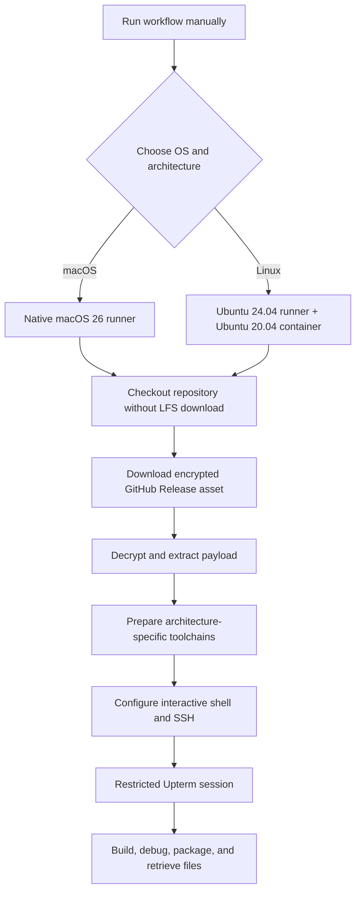

<a id="top"></a>

<div align="center">

# 🐧 🍎 Unix Runner

### Four runner configurations. Two operating systems. Two CPU architectures.

**On-demand GitHub Actions runners for building, packaging, and debugging native Unix applications over SSH.**

[](https://github.com/actions/runner-images)
[](https://ubuntu.com/)
[](#runner-matrix)
[](https://github.com/jgfPereira/unix-runner/actions)

**[Quick start](#quick-start)** · **[Runners](#runner-matrix)** · **[Release payload](#managing-the-encrypted-payload)** · **[Toolchains](#toolchains--platform-differences)** · **[Commands](#command-reference)** · **[Troubleshooting](#troubleshooting)**

</div>

---

## Overview

**Unix Runner** turns an ordinary workflow dispatch into a temporary, remotely accessible development machine. Each run provisions the relevant build tools, decrypts an encrypted source payload, and opens a restricted [Upterm](https://github.com/owenthereal/action-upterm) SSH session for hands-on work.

It is designed for workloads where **native operating systems and CPU architectures matter**: Java `jpackage` application images, macOS `.app` / `.dmg` / `.pkg` packaging, Linux AppImage creation, native Go programs, and other architecture-specific build or debugging tasks. The runners are **project-agnostic**: bring your own encrypted source payload and run the tools or build scripts appropriate to that project.

> [!IMPORTANT]
> These are **interactive provisioning workflows**, not fully unattended build-and-release pipelines. They prepare the environment and wait at the Upterm step. You run your build scripts in the SSH session and transfer the resulting files yourself. No executable is published automatically.

### What you get

- **Four explicitly selected environments:** macOS 26 on Apple Silicon and Intel; Ubuntu 20.04 containers on ARM64 and x64 hosts.
- **Oracle JDK 25** with `java`, `javac`, `jlink`, and `jpackage` available for Java desktop packaging.
- **Go, Maven, Python, ImageMagick, OpenSSL, ZIP utilities**, and OS-specific packaging tools.
- **Encrypted payload provisioning:** A GitHub Release asset (`payload.zip.enc`) is downloaded over HTTPS, decrypted using the `ZIP_PASSWORD` repository secret, and extracted on the runner. The asset is **publicly downloadable**; only its contents are encrypted.
- **Interactive SSH:** Upterm sessions restricted to the registered GitHub SSH keys of `jgfPereira`.
- **Comfortable remote terminals:** colorized Zsh/Bash sessions on macOS and Bash on Linux, with aliases and completion support.
- **Native packaging:** Apple's Xcode/macOS utilities on macOS; `appimagetool` and desktop integration utilities on Linux.

## Runner matrix

| Workflow | GitHub runner label | Actual build environment | Architecture | Interactive shell |
|:--|:--|:--|:--|:--|
| [`macos-arm64.yml`](.github/workflows/macos-arm64.yml) | `macos-26` | Native macOS 26 | Apple Silicon (`arm64`) | Zsh; Bash available |
| [`macos-x64.yml`](.github/workflows/macos-x64.yml) | `macos-26-intel` | Native macOS 26 | Intel (`x86_64`) | Zsh; Bash available |
| [`linux-arm64.yml`](.github/workflows/linux-arm64.yml) | `ubuntu-24.04-arm` | `ubuntu:20.04` Docker container | ARM64 (`aarch64`) | Bash |
| [`linux-x64.yml`](.github/workflows/linux-x64.yml) | `ubuntu-24.04` | `ubuntu:20.04` Docker container | x64 (`x86_64`) | Bash |

All four workflows are **manual** (`workflow_dispatch`) and currently use a **30-minute job timeout**. The selected architecture is the architecture of the machine executing the native build; macOS jobs are not cross-compilation containers.

### How a session starts



## Quick start

### 1. Prepare the GitHub repository

You need:

1. Access to [the repository](https://github.com/jgfPereira/unix-runner) and permission to run GitHub Actions workflows.
2. An SSH **public key registered with the GitHub account `jgfPereira`**. The matching private key must be available on the computer from which you connect.
3. The Actions repository secret **`ZIP_PASSWORD`**, matching the passphrase used to encrypt `payload.zip.enc`.
4. A published [**Runner Payload** release](https://github.com/jgfPereira/unix-runner/releases/tag/runner-payload) with an asset named exactly `payload.zip.enc`. See [Managing the encrypted payload](#managing-the-encrypted-payload).

Configure the secret in **Settings → Secrets and variables → Actions → New repository secret**, or use GitHub CLI:

```bash
gh secret set ZIP_PASSWORD
```

> [!NOTE]
> The password must match the one used when creating `payload.zip.enc`. Switching from LFS to GitHub Releases does **not** change the encryption format or require decrypting/re-encrypting an existing valid archive. The fixed release tag is `runner-payload`; check that every workflow uses that tag, **not `runner-payload-v1`**.

### 2. Start a machine

From the repository's **Actions** tab, select one of the four workflows and click **Run workflow**.

Alternatively, from a local machine with [GitHub CLI](https://cli.github.com/) authenticated:

```bash
# Apple Silicon Mac
gh workflow run macos-arm64.yml --ref main

# Intel Mac
gh workflow run macos-x64.yml --ref main

# Linux ARM64
gh workflow run linux-arm64.yml --ref main

# Linux x64
gh workflow run linux-x64.yml --ref main
```

Inspect the run from the web UI, or use:

```bash
gh run list --workflow macos-arm64.yml --limit 5
gh run watch <RUN_ID>
```

### 3. Connect through Upterm

Wait for the step **Start secure interactive SSH session**. It prints a session-specific SSH connection command in the workflow log. **Copy and use the complete command from that run**; the connection identifier is different for each session.

```bash
# Example shape only — use the exact command in the Actions log.
ssh <SESSION_ID>@uptermd.upterm.dev
```

Upterm checks that your SSH key belongs to the permitted GitHub account. A public run log does **not** grant the reader SSH access by itself.

After connecting:

```bash
# Works in both Linux and macOS sessions
uname -s
uname -m
echo "$GITHUB_WORKSPACE"
cd "$GITHUB_WORKSPACE/extracted_files"
ls -la
```

The workspace location is environment-specific. In the current setup, Linux container workspaces commonly live below `/__w/`, whereas macOS runner workspaces commonly live below `/Users/runner/work/`. **Use `$GITHUB_WORKSPACE` instead of hardcoding either path.**

### 4. Run your build

Inspect the extracted archive, identify the project directory, and run the build commands appropriate to that project:

```bash
cd "$GITHUB_WORKSPACE/extracted_files"
ls -la

# Locate common build entry points.
find . -maxdepth 4 -type f \
  \( -name 'pom.xml' -o -name 'go.mod' -o -name 'Makefile' -o -name 'build*.sh' \) \
  -print

# Example: build a Maven project (replace the directory name).
cd "$GITHUB_WORKSPACE/extracted_files/my-project"
mvn clean package
```

For projects with their own platform-specific scripts, run the relevant script from the project directory. For example:

```bash
# macOS: illustrative unsigned packaging command.
./scripts/build-macos.sh --skip-signing

# Linux: illustrative native packaging command.
./scripts/build-linux.sh
```

The script names and options above are **examples, not built-in commands**. **Unix Runner provisions the machine; your encrypted payload supplies the project, build scripts, configuration, and build outputs.** Nothing in this repository requires any specific application name or project layout.

### 5. Collect your build output

Start by finding files in the SSH session:

```bash
find "$GITHUB_WORKSPACE/extracted_files" -type f \
  \( -name '*.AppImage' -o -name '*.dmg' -o -name '*.pkg' -o -name '*.zip' \) \
  -print
```

For macOS `.app` bundles, prefer an archive made using Apple's `ditto`, which preserves macOS metadata and symlinks:

```bash
# Replace these example paths with your application's actual paths.
ditto -c -k --keepParent "path/to/YourApp.app" "path/to/YourApp-macos.zip"
```

Retrieve an individual artifact using SCP and the session-specific Upterm destination. Use the artifact's **absolute path on the runner**, and execute this command on **your local machine**:

```bash
scp -o ServerAliveInterval=30 -l 8192 \
  '<SESSION_ID>@uptermd.upterm.dev:/ABSOLUTE/PATH/TO/ARTIFACT.zip' .
```

Modern OpenSSH uses SFTP for SCP transfers by default; **no `-O` option is needed in the standard command**. Some older or differently configured Upterm/SSH endpoints may require **legacy SCP mode**, which can be enabled by adding `-O` if the default transfer fails with an SFTP-related error. Conversely, if `-O` causes a transfer failure, leave it out. Use the transfer mode that works with your session and client.

The `-l 8192` option caps bandwidth at **8,192 Kbit/s** (about 1 MiB/s), not a speed guarantee. Omit `-l 8192` if you do not want a bandwidth limit.

---

## Toolchains & platform differences

| Tool | macOS ARM64 / x64 | Linux ARM64 / x64 |
|:--|:--|:--|
| Operating system | Native macOS 26 | Ubuntu 20.04 inside Docker |
| JDK | Official Oracle JDK 25 macOS archive | Official Oracle JDK 25 Linux archive |
| Java packaging | `jpackage`, `jlink` | `jpackage`, `jlink` |
| Go | Homebrew `go` formula | Latest version downloaded from `go.dev` |
| Maven | Homebrew | Ubuntu package |
| Python | Homebrew `python` | Ubuntu package |
| ImageMagick | Homebrew; `magick` | Ubuntu package; `convert` |
| OpenSSL | Homebrew `openssl@3` | Ubuntu package |
| Shell completion | Native Zsh; Homebrew Bash completion | `bash-completion` package |
| Native packaging | `codesign`, `hdiutil`, `ditto`, `iconutil`, `sips`, `pkgbuild`, `productbuild`, Xcode CLT | `appimagetool`, `file`, `desktop-file-utils`, `binutils` |
| AppImage-specific workaround | Not applicable | `APPIMAGE_EXTRACT_AND_RUN=1` |

### Why Linux runs inside Docker

The Ubuntu 24.04 runner hosts execute a **clean Ubuntu 20.04 container** to control the Linux distribution and its runtime compatibility. That older image does not necessarily include suitable versions of Go or other tools, so the workflows explicitly bootstrap system packages, retrieve a current Go toolchain, and install architecture-matched AppImage tooling.

Docker is **not** used for macOS, because macOS `.app`/`.dmg` packaging requires native macOS tooling. Apple runners already contain Homebrew, Xcode-related tools, and OS packaging utilities. The macOS workflows therefore use those native facilities rather than reproducing Linux's `apt-get`, `update-alternatives`, GNU `objcopy`, or AppImage steps.

### Oracle JDK on macOS

The updated macOS workflows download the **Oracle JDK 25 archive matching the runner architecture**, install it into the runner user's `~/Library/Java/JavaVirtualMachines/`, and expose its `Contents/Home` directory as `JAVA_HOME`.

`JAVA_HOME` and the paths for Java, Homebrew, and OpenSSL are also written to the interactive shell configuration, so tools still resolve correctly **after connecting by SSH**, not just during GitHub Actions steps. The workflows verify `java`, `javac`, `jlink`, `jpackage`, and Maven using the configured environment.

The macOS runner also makes Apple's signing and packaging commands available, but the workflows **do not automatically sign, notarize, or publish** build outputs. Those actions require an appropriate signing identity, credentials, and a separate build/release procedure.

### Terminal behavior

| Platform | Shell features |
|:--|:--|
| macOS Zsh | Colored prompt, native `compinit` completion, history, `ls -G` aliases, Go/Java/Homebrew paths |
| macOS Bash | Colored prompt, history, aliases, Bash completion when available, Java/Homebrew paths |
| Linux Bash | Colored prompt, command aliases, completion, history, terminal size handling |

All workflows configure an SSH keepalive entry for `uptermd.upterm.dev` with `ServerAliveInterval 30` and `ServerAliveCountMax 3`.

---

## Repository layout

```text
unix-runner/
├── .github/
│   └── workflows/
│       ├── linux-arm64.yml       # Ubuntu 20.04 in ARM64 container
│       ├── linux-x64.yml         # Ubuntu 20.04 in x64 container
│       ├── macos-arm64.yml       # Native macOS 26 / Apple Silicon
│       └── macos-x64.yml         # Native macOS 26 / Intel
├── .gitignore                   # Ignore local payload files (recommended)
└── README.md

GitHub Releases (outside the Git tree)
└── runner-payload               # Fixed release tag
    └── payload.zip.enc          # Encrypted, publicly downloadable asset
```

After a workflow starts, the downloaded encrypted asset and extracted payload appear **in the temporary runner workspace**, not as committed repository files:

```text
$GITHUB_WORKSPACE/
├── payload.zip.enc
├── payload.zip                  # Decrypted only on the temporary runner
└── extracted_files/
    └── my-project/              # Example; actual layout comes from your ZIP
        ├── scripts/
        └── ...
```

## Managing the encrypted payload

The payload is maintained **separately from the Git repository** as an asset on a single, published GitHub Release. This is a distribution mechanism for build inputs, **not** a GitHub Actions build artifact or a conventional application release.

| Setting | Value |
|:--|:--|
| Repository | [`jgfPereira/unix-runner`](https://github.com/jgfPereira/unix-runner) |
| Fixed release tag | **`runner-payload`** |
| Release title | `Runner Payload` |
| Asset filename | **`payload.zip.enc`** |
| Download URL | [`releases/download/runner-payload/payload.zip.enc`](https://github.com/jgfPereira/unix-runner/releases/download/runner-payload/payload.zip.enc) |
| Decryption secret | GitHub Actions repository secret **`ZIP_PASSWORD`** |

> [!IMPORTANT]
> **Keep the release tag and asset filename unchanged.** The workflows download this specific URL on each run. Updating the asset under the existing tag makes the newest payload available to the next run without changing the workflow files. If your installed workflows still say `release_tag="runner-payload-v1"`, change that line to `release_tag="runner-payload"` in all four workflows **once**.

### Why we no longer use Git LFS

Earlier versions stored `payload.zip.enc` as a **Git LFS object**. Every fresh runner had to fetch that large object during checkout, consuming the repository owner's LFS download bandwidth. When the LFS budget was exceeded, checkout could fail with:

```text
batch response: This repository exceeded its LFS budget.
The account responsible for the budget should increase it to restore access.
```

GitHub Releases are better suited to this repository's workflow: a single relatively large encrypted payload is **downloaded repeatedly by temporary runners** and occasionally replaced in its entirety.

| | Git LFS (old) | GitHub Release asset (current) |
|:--|:--|:--|
| Where the payload lives | LFS object referenced by Git | Asset attached to `runner-payload` |
| Runner retrieval | Git LFS fetch during checkout | Direct HTTPS download after checkout |
| Budget impact | Consumes Git LFS storage/download allowance | Does **not** consume Git LFS allowance |
| Updating the payload | Commit and push another LFS object | Replace the asset using `--clobber` |
| Workflow changes per update | Git history changes | **None**, if tag and name stay fixed |
| Public access | LFS object in a public repository | Release asset publicly downloadable |

GitHub currently allows release asset files **under 2 GiB** each, with up to **1,000 assets per release**, and states no release-asset bandwidth cap. Other GitHub service and Actions usage policies still apply. See [GitHub's release documentation](https://docs.github.com/en/repositories/releasing-projects-on-github/about-releases).

> [!NOTE]
> Removing the file from current Git LFS tracking prevents *future* runner downloads through LFS. **It does not automatically erase LFS objects already stored in GitHub's history or immediately reclaim historical LFS storage usage.** Consult [GitHub's LFS removal documentation](https://docs.github.com/en/repositories/working-with-files/managing-large-files/removing-files-from-git-large-file-storage) if cleaning up that history or billing matters.

### 1. Prepare and encrypt the payload

Create a normal ZIP (`payload.zip`) containing the source files, scripts, and build inputs needed by the runners. The archive's internal directory structure is up to your project; it is extracted into `$GITHUB_WORKSPACE/extracted_files`.

Encrypt it **locally** using the existing OpenSSL AES-256-CBC / PBKDF2 format:

```bash
# The command prompts for a passphrase; do not put it in shell history.
openssl enc -aes-256-cbc -salt -pbkdf2 \
  -in payload.zip \
  -out payload.zip.enc

# Confirm the encrypted file exists and is not empty.
ls -lh payload.zip.enc
```

On Windows PowerShell, use the same OpenSSL command on one line if OpenSSL is installed:

```powershell
openssl enc -aes-256-cbc -salt -pbkdf2 -in payload.zip -out payload.zip.enc
Get-Item .\payload.zip.enc
```

Set the **`ZIP_PASSWORD`** Actions secret to the *same passphrase*, if you have not already done so:

```bash
gh secret set ZIP_PASSWORD --repo jgfPereira/unix-runner
```

If the previously LFS-tracked `payload.zip.enc` is already available **as a full local file**, you can upload it directly; do **not** encrypt it again. A Git LFS *pointer file* is not the encrypted payload. If the LFS quota is exhausted, you may need to retrieve the original from an existing local backup.

### 2. First-time upload: create the release

Install and authenticate the [GitHub CLI](https://cli.github.com/) (`gh auth login`). Run the following **once**, from the directory containing `payload.zip.enc`.

**Windows PowerShell** (matches the command used to initialize this repository):

```powershell
gh release create runner-payload .\payload.zip.enc `
  --repo jgfPereira/unix-runner `
  --title "Runner Payload" `
  --notes "Encrypted build payload for Unix runners." `
  --latest=false
```

**Linux / macOS shell:**

```bash
gh release create runner-payload ./payload.zip.enc \
  --repo jgfPereira/unix-runner \
  --title "Runner Payload" \
  --notes "Encrypted build payload for Unix runners." \
  --latest=false
```

You can instead create a new release at the [Releases page](https://github.com/jgfPereira/unix-runner/releases), choose tag **`runner-payload`**, attach **`payload.zip.enc`** in the assets area, and publish. Upload the **file**, not the automatically generated “Source code (zip)” archive.

**Verify the published asset:**

```bash
gh release view runner-payload --repo jgfPereira/unix-runner --web
# Or list assets directly:
gh release view runner-payload --repo jgfPereira/unix-runner --json assets --jq '.assets[].name'
```

> [!TIP]
> The release has already been created for this repository. **Do not run `gh release create` again to update the payload**; use the replacement command below.

### 3. Update the payload later — keep the same tag

Rebuild/re-encrypt your local payload as required, keeping the asset filename **exactly `payload.zip.enc`**. Then replace the existing release asset.

**Windows PowerShell:**

```powershell
gh release upload runner-payload .\payload.zip.enc --repo jgfPereira/unix-runner --clobber
```

**Linux / macOS shell:**

```bash
gh release upload runner-payload ./payload.zip.enc --repo jgfPereira/unix-runner --clobber
```

The command keeps the **release tag, title, and download URL unchanged**. On the next workflow execution, the download step fetches the new file; no commit, new tag, or workflow edit is required.

> [!WARNING]
> **`--clobber` is not an atomic replacement.** GitHub CLI deletes the existing asset before uploading the replacement. If the upload fails, there may temporarily be **no** `payload.zip.enc` asset to download. Avoid starting workflows during an update, keep a verified backup, and confirm the asset is present afterward. This replacement strategy also requires **release immutability to be disabled**: immutable published releases do not allow asset deletion/replacement. See [GitHub CLI documentation](https://cli.github.com/manual/gh_release_upload) and [immutable releases](https://docs.github.com/en/repositories/releasing-projects-on-github/about-releases).

A fixed tag is convenient, but **not reproducible by itself**: two workflow runs can use different payload bytes even when checking out the same Git commit. For release-critical builds, record the payload's SHA-256 hash and preserve an immutable copy elsewhere.

### 4. Migrate away from legacy LFS tracking (one-time)

If your repository still tracks `payload.zip.enc` through LFS, remove only that tracking rule and its index entry **after** confirming the Release asset works. Run from a local repository checkout with Git LFS installed:

```bash
git lfs untrack "payload.zip.enc"
git rm --cached -- payload.zip.enc
```

Add the following patterns to `.gitignore` (without removing any existing entries):

```gitignore
payload.zip.enc
payload.zip
extracted_files/
```

Commit the resulting changes:

```bash
git add .gitattributes .gitignore
git commit -m "Use GitHub Release for encrypted runner payload"
git push
```

`git rm --cached` untracks the file **without deleting your local copy**. Only add the indicated `.gitignore` patterns once. If the LFS tracking rule or Git index entry has already been removed, skip the corresponding command; do not rewrite repository history just to switch the workflow download method.

The workflows also use `GIT_LFS_SKIP_SMUDGE=1` on checkout as protection against accidentally fetching historical LFS content. They do **not** need Git LFS installed in the runner environment to download the release asset.

### 5. What happens during a workflow run

The payload download is identical in principle on macOS and Linux:

```bash
release_tag="runner-payload"
download_url="https://github.com/${GITHUB_REPOSITORY}/releases/download/${release_tag}/payload.zip.enc"

curl --fail --location --show-error --silent --retry 3 --retry-delay 5 \
  --output payload.zip.enc.download "$download_url"
test -s payload.zip.enc.download
mv -f payload.zip.enc.download payload.zip.enc
```

The temporary `.download` filename helps avoid treating an interrupted transfer as a completed archive. The existing decryption and extraction stages then produce:

```text
$GITHUB_WORKSPACE/
├── payload.zip.enc         # Downloaded encrypted Release asset
├── payload.zip             # Decrypted ZIP, only on temporary runner
└── extracted_files/        # Files made available for interactive builds
```

The macOS workflows supply `ZIP_PASSWORD` as a step-scoped environment variable and test ZIP integrity before extraction. The **Linux workflows retain their original OpenSSL `-k` invocation**. Both decrypt the same archive format with the repository secret.

> [!CAUTION]
> **The Release asset is public, not secret storage.** Anyone can download `payload.zip.enc` from this public repository. Protect `ZIP_PASSWORD` with a strong unique passphrase and keep it in GitHub Actions secrets. AES-256-CBC through `openssl enc` with PBKDF2 provides encryption but **not authenticated integrity**; retain a trusted checksum or provenance record for important updates. Never upload the plaintext ZIP, signing keys, certificates, credentials, or decrypted build outputs to a public release. Decrypted files exist on the temporary runner and are accessible to authorized SSH session users.

---

## Command reference

### Environment and architecture

```bash
uname -a
uname -m
echo "$GITHUB_WORKSPACE"
pwd
ls -la
file path/to/executable
```

### Java, Maven, Go and packaging

```bash
java -version
javac -version
jpackage --version
jlink --version
mvn -version
go version
go env GOOS GOARCH
python3 --version
```

### Useful macOS commands

```bash
sw_vers
/usr/libexec/java_home -V
xcode-select -p
xcrun --find clang
magick -version
iconutil --help
sips -g pixelWidth -g pixelHeight path/to/icon.png
codesign -dv --verbose=4 path/to/app.app
codesign --verify --deep --verbose=2 path/to/app.app
hdiutil imageinfo path/to/application.dmg
```

`codesign` verification reports missing signatures when testing unsigned development builds; that is expected if your build script uses `--skip-signing`.

### Useful Linux / AppImage commands

```bash
cat /etc/os-release
convert -version
command -v objcopy
command -v appimagetool
APPIMAGE_EXTRACT_AND_RUN=1 appimagetool --version
file path/to/application.AppImage
```

### Archives and diagnostics

```bash
unzip -t payload.zip
unzip -l payload.zip | head -n 20
find "$GITHUB_WORKSPACE/extracted_files" -maxdepth 3 -type f | head -n 30
du -sh "$GITHUB_WORKSPACE/extracted_files"
df -h
```

### GitHub Actions from your local machine

```bash
gh workflow list
gh workflow run macos-arm64.yml --ref main
gh run list --limit 10
gh run view <RUN_ID> --log
gh run cancel <RUN_ID>
```

---

## Troubleshooting

<details>
<summary><strong>Release download fails (404, 403, or empty file)</strong></summary>

Check that the release is **published** and the asset is named exactly `payload.zip.enc`. Verify that all four workflows use `release_tag="runner-payload"` (not `runner-payload-v1`). If an upload with `--clobber` is in progress or failed, the asset may be temporarily missing; check the [release page](https://github.com/jgfPereira/unix-runner/releases/tag/runner-payload) and re-upload from your local backup. The release and asset URL must remain public for the workflows' unauthenticated `curl` download.

</details>

<details>
<summary><strong>Git LFS budget error still appears</strong></summary>

Confirm that you are executing the **new** workflows, not an older Git branch or a workflow still using `actions/checkout` with `lfs: true`. The release-based workflows disable LFS smudging during checkout and download the payload separately. Existing LFS objects may still count against storage until separately addressed, but the new jobs should not need LFS downloads.

</details>

<details>
<summary><strong>Decryption fails, or the ZIP cannot be tested</strong></summary>

Confirm that `ZIP_PASSWORD` exists under the repository's **Actions secrets**, is not empty, and matches the encryption passphrase. Confirm that the [fixed Release asset](https://github.com/jgfPereira/unix-runner/releases/tag/runner-payload) contains the complete, correctly encrypted archive (rather than a small historical LFS pointer). Check that `ZIP_PASSWORD` matches the encryption passphrase. The macOS workflows fail early if decryption or ZIP integrity validation fails.

</details>

<details>
<summary><strong>macOS uses the wrong Java version</strong></summary>

Run `echo "$JAVA_HOME"`, `which java`, `java -version`, `jpackage --version`, and `mvn -version`. The updated macOS workflows explicitly prepend the downloaded Oracle JDK and persist its path for SSH login shells. If you switch shells manually, source `~/.unix-runner-env`.

</details>

<details>
<summary><strong>Homebrew is slow or a dependency fails to install</strong></summary>

The macOS workflows set `HOMEBREW_NO_AUTO_UPDATE=1` and `HOMEBREW_NO_INSTALL_CLEANUP=1` to avoid unnecessary per-run maintenance. GitHub-hosted images and Homebrew formula versions still change over time; inspect the failing step's log, or retry with a fresh runner. Installed versions are checked before the Upterm session begins.

</details>

<details>
<summary><strong>SSH access is denied</strong></summary>

Confirm that your **public** SSH key is registered to GitHub user `jgfPereira`, the corresponding private key is loaded by your SSH client, and you copied the exact current Upterm connection command. If your key is not the default, connect using `ssh -i /path/to/key ...`. Sessions are temporary and end when the job exits, is cancelled, or times out.

</details>

<details>
<summary><strong>SSH / SFTP connections intermittently hang</strong></summary>

Upterm uses a public relay, so connectivity or forwarding issues can affect SSH/SFTP independently from the build. If the connection closes before key exchange, retry with `ssh -o ConnectTimeout=10 -o ServerAliveInterval=15 -o ServerAliveCountMax=3 <SESSION_ID>@uptermd.upterm.dev`, and check that the workflow session is still active. If large transfers stall, try SFTP with fewer outstanding requests (`sftp -R 4 -B 16384 ...`) and use `reget` to resume a partial download. Keepalives cannot fix a stalled relay or a subsystem that still acknowledges SSH probes. For important builds, consider an explicit artifact-upload step as a separate retrieval channel; the current provisioning workflows do not publish build artifacts automatically.

</details>

<details>
<summary><strong>My session disconnected unexpectedly</strong></summary>

SSH keepalives help with idle network connections but **do not extend GitHub's job timeout**. These workflows have `timeout-minutes: 30`, covering setup and interactive time. Increase that value in the selected workflow if your builds need longer sessions. On Upterm v2, disconnecting the SSH client does not necessarily end the session; issuing `exit` normally does.

</details>

<details>
<summary><strong>AppImage or macOS packaging is unavailable</strong></summary>

AppImage is intentionally **Linux only**; `APPIMAGE_EXTRACT_AND_RUN=1` supports AppImage tooling in the Docker container without FUSE. macOS instead uses native `.app`, `.dmg`, `.pkg`, `iconutil`, and code-signing tools. Verify you selected the correct workflow for the target platform, and remember that signing and notarization are not performed by these provisioning workflows.

</details>

## Security and operating considerations

- **Restrict SSH access.** The workflows explicitly allow only the registered keys of `jgfPereira` through Upterm. Do not remove this restriction for jobs containing decrypted artifacts.
- **Encrypt public Release assets.** The encrypted payload is downloadable by anyone; keep `ZIP_PASSWORD` strong and private, and never upload plaintext archives or decrypted `extracted_files` to public releases/artifacts.
- **Understand the lifespan.** Hosted runners are temporary. All files and changes not retrieved elsewhere disappear when the job ends.
- **Keep action permissions narrow.** The macOS jobs request `contents: read` and disable persisted checkout credentials. Linux remains container-based. No workflows require LFS checkout or write access to GitHub Releases for downloads.
- **Manage toolchain drift.** Homebrew formula versions, Go latest-stable, Oracle JDK 25 patch levels, runner images, and `appimagetool` continuous releases can change between runs. Pin versions and action commit SHAs if you require reproducible, audited release builds.
- **Account for usage and consistency.** GitHub Actions usage and quotas depend on repository visibility and account plan. An active SSH session consumes a running job. The fixed `runner-payload` tag always refers to the currently uploaded asset, so record its checksum when reproducibility matters.

## Further reading

- [GitHub Actions workflows](https://docs.github.com/en/actions/writing-workflows)
- [GitHub-hosted runners](https://docs.github.com/en/actions/reference/runners/github-hosted-runners)
- [Upterm action documentation](https://github.com/owenthereal/action-upterm)
- [GitHub Releases and asset limits](https://docs.github.com/en/repositories/releasing-projects-on-github/about-releases)
- [GitHub CLI: create and upload assets](https://cli.github.com/manual/gh_release_upload)
- [Git LFS removal and historical storage](https://docs.github.com/en/repositories/working-with-files/managing-large-files/removing-files-from-git-large-file-storage)
- [Oracle JDK 25 downloads](https://www.oracle.com/java/technologies/downloads/)
- [Java `jpackage` documentation](https://docs.oracle.com/en/java/javase/25/docs/specs/man/jpackage.html)
- [AppImage documentation](https://docs.appimage.org/)

---

<div align="center">

**Build natively. Connect securely. Package for the right architecture.**

[Back to top](#top)

</div>
