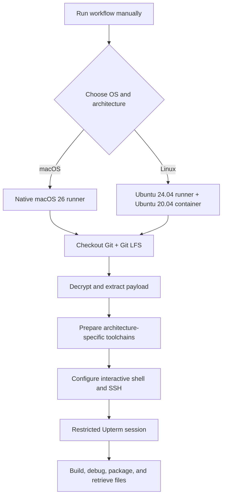

<a id="top"></a>

<div align="center">

# 🐧 🍎 Unix Runner

### Four architectures. Two operating systems. One interactive build environment.

**On-demand GitHub Actions runners for building, packaging, and debugging native Unix applications over SSH.**

[](https://github.com/actions/runner-images)
[](https://ubuntu.com/)
[](#runner-matrix)
[](https://github.com/jgfPereira/unix-runner/actions)

**[Quick start](#quick-start)** · **[Runners](#runner-matrix)** · **[Toolchains](#toolchains--platform-differences)** · **[Command reference](#command-reference)** · **[Troubleshooting](#troubleshooting)**

</div>

---

## Overview

**Unix Runner** turns an ordinary workflow dispatch into a temporary, remotely accessible development machine. Each run provisions the relevant build tools, decrypts an encrypted source payload, and opens a restricted [Upterm](https://github.com/owenthereal/action-upterm) SSH session for hands-on work.

It is designed for workloads where **native host architecture matters**, such as Java `jpackage` application images, macOS `.app` / `.dmg` packaging, and Linux AppImage creation. It is particularly useful for building the **iSign** Java desktop application across x64 and ARM64.

> [!IMPORTANT]
> These are **interactive provisioning workflows**, not fully unattended build-and-release pipelines. They prepare the environment and wait at the Upterm step. You run your build scripts in the SSH session and transfer the resulting files yourself. No executable is published automatically.

### What you get

- **Four explicitly selected environments:** macOS 26 on Apple Silicon and Intel; Ubuntu 20.04 containers on ARM64 and x64 hosts.
- **Oracle JDK 25** with `java`, `javac`, `jlink`, and `jpackage` available for Java desktop packaging.
- **Go, Maven, Python, ImageMagick, OpenSSL, ZIP utilities**, and OS-specific packaging tools.
- **Private payload provisioning:** Git LFS–tracked, AES-256-CBC / PBKDF2–encrypted `payload.zip.enc`, decrypted using the `ZIP_PASSWORD` repository secret.
- **Interactive SSH:** Upterm sessions restricted to the registered GitHub SSH keys of `jgfPereira`.
- **Comfortable remote terminals:** colorized Zsh/Bash sessions on macOS and Bash on Linux, with aliases and completion support.
- **Native packaging:** Apple's Xcode/macOS utilities on macOS; `appimagetool` and desktop integration utilities on Linux.

## Runner matrix

| Workflow | GitHub runner label | Actual build environment | Architecture | Interactive shell |
|:--|:--|:--|:--|:--|
| [`macos-arm64.yml`](.github/workflows/macos-arm64.yml) | `macos-26` | Native macOS 26 | Apple Silicon (`arm64`) | Zsh; Bash available |
| [`macos-x64.yml`](.github/workflows/macos-x64.yml) | `macos-26-intel` | Native macOS 26 | Intel (`x86_64`) | Zsh; Bash available |
| [`linux-arm64.yml`](.github/workflows/linux-arm64.yml) | `ubuntu-24.04-arm` | `ubuntu:20.04` Docker container | ARM64 (`aarch64`) | Bash |
| [`linux-x64.yml`](.github/workflows/linux-x64.yml) | `ubuntu-24.04` | `ubuntu:20.04` Docker container | x64 (`x86_64`) | Bash |

All four workflows are **manual** (`workflow_dispatch`) and currently use a **30-minute job timeout**. The selected architecture is the architecture of the machine executing the native build; macOS jobs are not cross-compilation containers.

### How a session starts



## Quick start

### 1. Prepare the GitHub repository

You need:

1. Access to [the repository](https://github.com/jgfPereira/unix-runner) and permission to run GitHub Actions workflows.
2. An SSH **public key registered with the GitHub account `jgfPereira`**. The matching private key must be available on the computer from which you connect.
3. The Actions repository secret **`ZIP_PASSWORD`**, matching the passphrase used to encrypt `payload.zip.enc`.
4. A current encrypted payload committed to Git LFS.

Configure the secret in **Settings → Secrets and variables → Actions → New repository secret**, or use GitHub CLI:

```bash
gh secret set ZIP_PASSWORD
```

> [!NOTE]
> The password must match the one used when creating `payload.zip.enc`. These workflows deliberately retain the existing OpenSSL encryption format; no re-encryption or payload migration is needed.

### 2. Start a machine

From the repository's **Actions** tab, select one of the four workflows and click **Run workflow**.

Alternatively, from a local machine with [GitHub CLI](https://cli.github.com/) authenticated:

```bash
# Apple Silicon Mac
gh workflow run macos-arm64.yml --ref main

# Intel Mac
gh workflow run macos-x64.yml --ref main

# Linux ARM64
gh workflow run linux-arm64.yml --ref main

# Linux x64
gh workflow run linux-x64.yml --ref main
```

Inspect the run from the web UI, or use:

```bash
gh run list --workflow macos-arm64.yml --limit 5
gh run watch <RUN_ID>
```

### 3. Connect through Upterm

Wait for the step **Start secure interactive SSH session**. It prints a session-specific SSH connection command in the workflow log. **Copy and use the complete command from that run**; the connection identifier is different for each session.

```bash
# Example shape only — use the exact command in the Actions log.
ssh <SESSION_ID>@uptermd.upterm.dev
```

Upterm checks that your SSH key belongs to the permitted GitHub account. A public run log does **not** grant the reader SSH access by itself.

After connecting:

```bash
# Works in both Linux and macOS sessions
uname -s
uname -m
echo "$GITHUB_WORKSPACE"
cd "$GITHUB_WORKSPACE/extracted_files"
ls -la
```

The workspace location is environment-specific. In the current setup, Linux container workspaces commonly live below `/__w/`, whereas macOS runner workspaces commonly live below `/Users/runner/work/`. **Use `$GITHUB_WORKSPACE` instead of hardcoding either path.**

### 4. Run your build

If the extracted archive contains the iSign project with the expected layout:

```bash
cd "$GITHUB_WORKSPACE/extracted_files/isign"

# Inspect available build scripts
ls -la scripts/

# Example: native macOS packaging without signing
chmod +x scripts/build-macos.sh
./scripts/build-macos.sh --skip-signing
```

**Scripts inside the encrypted payload are separate from this repository.** The workflow provisions the environment, but the build behavior and artifact paths are defined by those scripts. The example above assumes `scripts/build-macos.sh` exists in the extracted project.

### 5. Collect your build output

Start by finding files in the SSH session:

```bash
find "$GITHUB_WORKSPACE/extracted_files" -type f \
  \( -name '*.AppImage' -o -name '*.dmg' -o -name '*.pkg' -o -name '*.zip' \) \
  -print
```

For macOS `.app` bundles, prefer an archive made using Apple's `ditto`, which preserves macOS metadata and symlinks:

```bash
# Replace the example path with your actual .app location.
ditto -c -k --keepParent "target/jpackage-output/iSign.app" "target/iSign-macos.zip"
```

You can attempt to retrieve an individual file using SCP and the same session-specific Upterm destination (with its actual absolute path):

```bash
# Run this on YOUR local computer, not inside the remote runner.
scp -O -o ServerAliveInterval=30 -l 8192 \
  '<SESSION_ID>@uptermd.upterm.dev:/ABSOLUTE/PATH/TO/ARTIFACT.zip' .
```

`-O` selects legacy SCP mode on modern OpenSSH clients; it can help with SSH servers that do not provide SFTP. File transfer behavior depends on the Upterm version, so verify the method on your live session. The `-l 8192` option is a bandwidth cap of **8,192 Kbit/s** (about 1 MiB/s), not a speed guarantee.

---

## Toolchains & platform differences

| Tool | macOS ARM64 / x64 | Linux ARM64 / x64 |
|:--|:--|:--|
| Operating system | Native macOS 26 | Ubuntu 20.04 inside Docker |
| JDK | Official Oracle JDK 25 macOS archive | Official Oracle JDK 25 Linux archive |
| Java packaging | `jpackage`, `jlink` | `jpackage`, `jlink` |
| Go | Homebrew `go` formula | Latest version downloaded from `go.dev` |
| Maven | Homebrew | Ubuntu package |
| Python | Homebrew `python` | Ubuntu package |
| ImageMagick | Homebrew; `magick` | Ubuntu package; `convert` |
| OpenSSL | Homebrew `openssl@3` | Ubuntu package |
| Shell completion | Native Zsh; Homebrew Bash completion | `bash-completion` package |
| Native packaging | `codesign`, `hdiutil`, `ditto`, `iconutil`, `sips`, `pkgbuild`, `productbuild`, Xcode CLT | `appimagetool`, `file`, `desktop-file-utils`, `binutils` |
| AppImage-specific workaround | Not applicable | `APPIMAGE_EXTRACT_AND_RUN=1` |

### Why Linux runs inside Docker

The Ubuntu 24.04 runner hosts execute a **clean Ubuntu 20.04 container** to control the Linux distribution and its runtime compatibility. That older image does not necessarily include suitable versions of Go or other tools, so the workflows explicitly bootstrap system packages, retrieve a current Go toolchain, and install architecture-matched AppImage tooling.

Docker is **not** used for macOS, because macOS `.app`/`.dmg` packaging requires native macOS tooling. Apple runners already contain Homebrew, Xcode-related tools, and OS packaging utilities. The macOS workflows therefore use those native facilities rather than reproducing Linux's `apt-get`, `update-alternatives`, GNU `objcopy`, or AppImage steps.

### Oracle JDK on macOS

The updated macOS workflows download the **Oracle JDK 25 archive matching the runner architecture**, install it into the runner user's `~/Library/Java/JavaVirtualMachines/`, and expose its `Contents/Home` directory as `JAVA_HOME`.

`JAVA_HOME` and the paths for Java, Homebrew, and OpenSSL are also written to the interactive shell configuration, so tools still resolve correctly **after connecting by SSH**, not just during GitHub Actions steps. The workflows verify `java`, `javac`, `jlink`, `jpackage`, and Maven using the configured environment.

The macOS runner also makes Apple's signing and packaging commands available, but the workflows **do not automatically sign, notarize, or publish** build outputs. Those actions require an appropriate signing identity, credentials, and a separate build/release procedure.

### Terminal behavior

| Platform | Shell features |
|:--|:--|
| macOS Zsh | Colored prompt, native `compinit` completion, history, `ls -G` aliases, Go/Java/Homebrew paths |
| macOS Bash | Colored prompt, history, aliases, Bash completion when available, Java/Homebrew paths |
| Linux Bash | Colored prompt, command aliases, completion, history, terminal size handling |

All workflows configure an SSH keepalive entry for `uptermd.upterm.dev` with `ServerAliveInterval 30` and `ServerAliveCountMax 3`.

---

## Repository layout

```text
unix-runner/
├── .github/
│   └── workflows/
│       ├── linux-arm64.yml       # Ubuntu 20.04 in ARM64 container
│       ├── linux-x64.yml         # Ubuntu 20.04 in x64 container
│       ├── macos-arm64.yml       # Native macOS 26 / Apple Silicon
│       └── macos-x64.yml         # Native macOS 26 / Intel
├── .gitattributes               # Git LFS tracking rules
├── payload.zip.enc              # Encrypted build payload (Git LFS)
└── README.md
```

After a workflow starts, the extracted payload appears **in the runtime workspace**, not as a committed source directory:

```text
$GITHUB_WORKSPACE/
├── payload.zip.enc
├── payload.zip                  # Decrypted only on the temporary runner
└── extracted_files/
    └── isign/                   # Example extracted project layout
        ├── scripts/
        └── ...
```

## Managing the encrypted payload

Create a normal ZIP archive of the project you wish to transfer, then encrypt it using the existing format:

```bash
# Opens an interactive passphrase prompt (do not add the password to the command).
openssl enc -aes-256-cbc -salt -pbkdf2 \
  -in payload.zip \
  -out payload.zip.enc

# Track the encrypted archive in Git LFS (if not already tracked).
git lfs track "payload.zip.enc"
git add .gitattributes payload.zip.enc
git commit -m "Update encrypted build payload"
git push
```

The workflows decrypt using the repository secret without placing the actual passphrase in the OpenSSL command-line arguments:

```bash
openssl enc -aes-256-cbc -d -pbkdf2 \
  -in payload.zip.enc \
  -out payload.zip \
  -pass env:ZIP_PASSWORD
```

`ZIP_PASSWORD` is injected only into the decryption step's environment in the updated macOS workflows. They also test ZIP integrity before extraction. The Linux workflows retain their existing decryption steps.

> [!CAUTION]
> **Encryption is not the same as authenticated storage.** AES-256-CBC via `openssl enc` with PBKDF2 does not authenticate the payload; the archive must still come from a trusted source. Never commit the plaintext ZIP, certificates, private keys, ticket credentials, signing credentials, or other sensitive build inputs. Decrypted files are accessible inside the live runner to anyone authorized into that session. Revoke or rotate any secret that was accidentally exposed in Git history.

---

## Command reference

### Environment and architecture

```bash
uname -a
uname -m
echo "$GITHUB_WORKSPACE"
pwd
ls -la
file path/to/executable
```

### Java, Maven, Go and packaging

```bash
java -version
javac -version
jpackage --version
jlink --version
mvn -version
go version
go env GOOS GOARCH
python3 --version
```

### Useful macOS commands

```bash
sw_vers
/usr/libexec/java_home -V
xcode-select -p
xcrun --find clang
magick -version
iconutil --help
sips -g pixelWidth -g pixelHeight path/to/icon.png
codesign -dv --verbose=4 path/to/app.app
codesign --verify --deep --verbose=2 path/to/app.app
hdiutil imageinfo path/to/application.dmg
```

`codesign` verification reports missing signatures when testing unsigned development builds; that is expected if your build script uses `--skip-signing`.

### Useful Linux / AppImage commands

```bash
cat /etc/os-release
convert -version
command -v objcopy
command -v appimagetool
APPIMAGE_EXTRACT_AND_RUN=1 appimagetool --version
file path/to/application.AppImage
```

### Archives and diagnostics

```bash
unzip -t payload.zip
unzip -l payload.zip | head -n 20
find "$GITHUB_WORKSPACE/extracted_files" -maxdepth 3 -type f | head -n 30
du -sh "$GITHUB_WORKSPACE/extracted_files"
df -h
```

### GitHub Actions from your local machine

```bash
gh workflow list
gh workflow run macos-arm64.yml --ref main
gh run list --limit 10
gh run view <RUN_ID> --log
gh run cancel <RUN_ID>
```

---

## Troubleshooting

<details>
<summary><strong>Decryption fails, or the ZIP cannot be tested</strong></summary>

Confirm that `ZIP_PASSWORD` exists under the repository's **Actions secrets**, is not empty, and matches the encryption passphrase. Check that `payload.zip.enc` was downloaded as the actual Git LFS object, not a small LFS pointer. The macOS workflows fail early if decryption or ZIP integrity validation fails.

</details>

<details>
<summary><strong>macOS uses the wrong Java version</strong></summary>

Run `echo "$JAVA_HOME"`, `which java`, `java -version`, `jpackage --version`, and `mvn -version`. The updated macOS workflows explicitly prepend the downloaded Oracle JDK and persist its path for SSH login shells. If you switch shells manually, source `~/.unix-runner-env`.

</details>

<details>
<summary><strong>Homebrew is slow or a dependency fails to install</strong></summary>

The macOS workflows set `HOMEBREW_NO_AUTO_UPDATE=1` and `HOMEBREW_NO_INSTALL_CLEANUP=1` to avoid unnecessary per-run maintenance. GitHub-hosted images and Homebrew formula versions still change over time; inspect the failing step's log, or retry with a fresh runner. Installed versions are checked before the Upterm session begins.

</details>

<details>
<summary><strong>SSH access is denied</strong></summary>

Confirm that your **public** SSH key is registered to GitHub user `jgfPereira`, the corresponding private key is loaded by your SSH client, and you copied the exact current Upterm connection command. If your key is not the default, connect using `ssh -i /path/to/key ...`. Sessions are temporary and end when the job exits, is cancelled, or times out.

</details>

<details>
<summary><strong>My session disconnected unexpectedly</strong></summary>

SSH keepalives help with idle network connections but **do not extend GitHub's job timeout**. These workflows have `timeout-minutes: 30`, covering setup and interactive time. Increase that value in the selected workflow if your builds need longer sessions. On Upterm v2, disconnecting the SSH client does not necessarily end the session; issuing `exit` normally does.

</details>

<details>
<summary><strong>AppImage or macOS packaging is unavailable</strong></summary>

AppImage is intentionally **Linux only**; `APPIMAGE_EXTRACT_AND_RUN=1` supports AppImage tooling in the Docker container without FUSE. macOS instead uses native `.app`, `.dmg`, `.pkg`, `iconutil`, and code-signing tools. Verify you selected the correct workflow for the target platform, and remember that signing and notarization are not performed by these provisioning workflows.

</details>

## Security and operating considerations

- **Restrict SSH access.** The workflows explicitly allow only the registered keys of `jgfPereira` through Upterm. Do not remove this restriction for jobs containing decrypted artifacts.
- **Keep build inputs private.** Use Git LFS for large encrypted archives, protect the ZIP passphrase as a repository secret, and never upload the decrypted `extracted_files` directory to public artifacts.
- **Understand the lifespan.** Hosted runners are temporary. All files and changes not retrieved elsewhere disappear when the job ends.
- **Keep action permissions narrow.** The updated macOS jobs request only `contents: read` and disable persisted checkout credentials. The Linux jobs have not been changed.
- **Manage toolchain drift.** Homebrew formula versions, Go latest-stable, Oracle JDK 25 patch levels, runner images, and `appimagetool` continuous releases can change between runs. Pin versions and action commit SHAs if you require reproducible, audited release builds.
- **Account for usage.** GitHub Actions usage and quotas depend on repository visibility and account plan. An active SSH session consumes a running job until the session ends or times out.

## Further reading

- [GitHub Actions workflows](https://docs.github.com/en/actions/writing-workflows)
- [GitHub-hosted runners](https://docs.github.com/en/actions/reference/runners/github-hosted-runners)
- [Upterm action documentation](https://github.com/owenthereal/action-upterm)
- [Git LFS](https://git-lfs.com/)
- [Oracle JDK 25 downloads](https://www.oracle.com/java/technologies/downloads/)
- [Java `jpackage` documentation](https://docs.oracle.com/en/java/javase/25/docs/specs/man/jpackage.html)
- [AppImage documentation](https://docs.appimage.org/)

---

<div align="center">

**Build natively. Connect securely. Package for the right architecture.**

[Back to top](#top)

</div>
